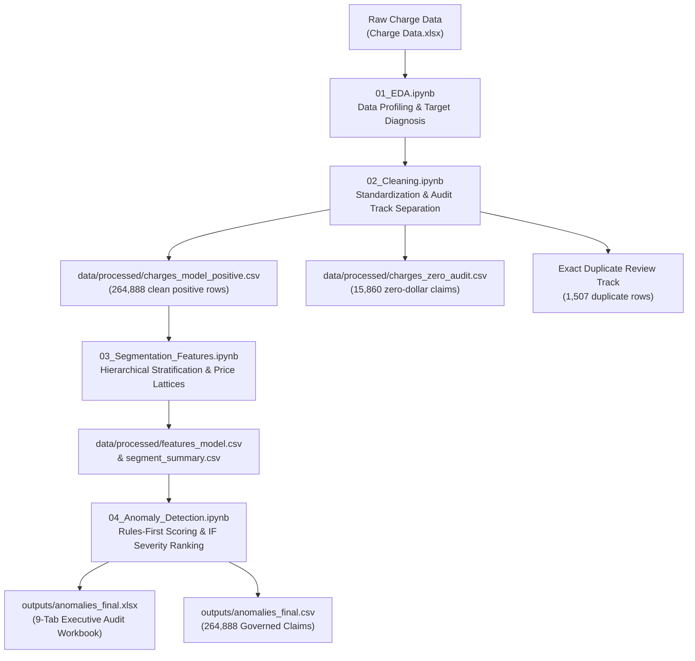

# Healthcare Billing Anomaly Detection Assessment
## Technical Documentation, Architecture, and Project Guide

> **Note:** This document serves as the primary system specification, methodology guide, and execution walkthrough for the Healthcare Billing Anomaly Detection project. It replaces standard repository readme formatting to provide an audit-ready, clinical-grade overview of the unsupervised anomaly detection pipeline.

---

## 1. Executive Summary & Project Purpose

The primary objective of this project is to detect unusual billing amounts in healthcare transactions using unsupervised machine learning and deterministic domain rules, stratified within clinically and operationally meaningful segments (e.g., Procedure/CPT, Service Line, Provider).

Healthcare billing differs fundamentally from traditional financial fraud detection:
1. **Discrete Chargemaster Lattice:** Charge amounts are not continuous Gaussian distributions. In this dataset of 280,748 line items, there are only **377 unique price points**. Over 98.2% of procedure charges sit exactly on a single modal chargemaster list price ($IQR = 0$). Standard unstratified IQR or Z-score outlier detection models collapse.
2. **Clinical & Contractual Context:** A deviation from the modal price is not automatically an error or fraud. Legitimate variations arise from multiple procedure payment reductions (MPPR), professional vs. global billing splits (e.g., modifier `-26`), bundled service supplies, or annual fee-schedule transitions.
3. **Non-Causal Governance:** Algorithmic findings represent **potential variance relative to list price**, separating high-priority isolated operational errors from systematic recurring contractual fee patterns and invoice-based acquisitions.

---

## 2. System Architecture & Sequential Pipeline

The assessment is architected into four sequential, self-contained Jupyter notebooks. Each phase generates versioned datasets and visual audit artifacts stored in `data/processed/`, `figures/`, and `outputs/`.



### Notebook Sequence Overview

1. **`01_EDA.ipynb` (Exploratory Data Analysis):**
   - Comprehensive profiling of 280,748 rows and 13 raw attributes.
   - Diagnosed severe skewness (skewness: 8.91, kurtosis: 133.58) and extreme median concentration ($IQR = 0$ across major procedures).
   - Identified 15,860 zero-dollar charges, 1,507 exact duplicates, and 3 constant administrative columns.
   - Visualized category distributions across 25 medical specialties and 26 billing providers.

2. **`02_Cleaning.ipynb` (Data Cleaning & Audit Separation):**
   - Standardized column taxonomy: `ProcedureCode` $\rightarrow$ `ProcedureID`, `ProcedureCode.1` $\rightarrow$ `CPTCode`.
   - Preserved leading zeros and alphanumeric HCPCS codes (`J3490`, `S1091`, `V5140`, `G0268`).
   - Standardized text casing and stripped whitespace across `ServiceLine` and `PayerCompanyName`.
   - Engineered billing lag metrics: `PostingLagDays = PostingDate - DateOfService`.
   - Established independent audit tracks: routed 15,860 zero charges to `charges_zero_audit.csv` and documented 1,507 exact duplicates without deleting valid positive outliers.
   - Exported 264,888 deduplicated positive claims to `data/processed/charges_model_positive.csv`.

3. **`03_Segmentation_Features.ipynb` (Segmentation & Feature Engineering):**
   - Evaluated chargemaster price structures across all CPT codes.
   - Established two-level segmentation hierarchy:
     - **Level 1 (CPT-Level):** Procedures with $N \ge 30$ claims (98 segments covering 263,990 claims, 99.66% of volume).
     - **Level 2 (ServiceLine Fallback):** Rare procedures with $N < 30$ claims (6 segments covering 898 claims, 0.34% of volume).
   - Engineered domain features: `LogRatioToRef`, `PriceRarity`, `IsModalPrice`, `UnitRateRatio`, `UnitsRatio`, and `PhysicianMedianLogRatio`.
   - Diagnosed 29 procedures with cross-year price shifts, differentiating true fee schedule transitions from coexisting concurrent prices.

4. **`04_Anomaly_Detection.ipynb` (Detection, Validation & Governance):**
   - Enforced **clean switch transition window**: restricted 90-day grace period exclusively to CPT `95117` (May 2025: \$36.50 $\rightarrow$ \$37.00; 7,709 claims exempted).
   - Flagged procedures with coexisting price tiers as `ConcurrentPrices = 1` (11,712 claims, e.g. CPT `95800` \$90 vs \$350) and subjected them to rule scoring.
   - Detected and isolated high-dispersion **invoice-priced codes** (`J3490`, `S1091`; 134 claims, \$1.83M billed) for manual acquisition cost audit.
   - Deployed **rules-first architecture**: deterministic baseline rules (Rules A, B, C) identify 100% of price and unit violations; **Isolation Forest** assigns continuous anomaly severity scores ($s(x) \in [0, 1]$) for audit queue triage.
   - Partitioned Level 1 flags into **Isolated Anomalies** (1,749 operational billing errors) vs. **Recurring Alternate Prices** (13,901 systematic contract/modifier patterns).
   - Executed synthetic stress injection testing across 8 corruption scenarios (3,200 claims).

---

## 3. Methodological Framework & Detection Rules

### Rules-First Architecture

Because healthcare charges follow a discrete chargemaster lattice, machine learning alone cannot outperform transparent list-price boundaries. Baseline rules serve as the inclusion criteria, while Isolation Forest ranks priority:

* **Rule A (Magnitude Deviation):** $|\text{LogRatioToRef}| > \ln(1.10)$ — flags charges deviating $> 10\%$ above or below the segment reference price.
* **Rule B (Off-List Price):** Flags any charge amount that was never established as a modal chargemaster list price for that procedure in any operating year.
* **Rule C (Unit Rate Mismatch):** $|\ln(\text{UnitRate} / \text{RefUnitRate})| > \ln(1.10)$ — flags multi-unit claims where the per-unit rate deviates $> 10\%$ from standard single-unit rates.
* **Isolation Forest Severity Ranking:** Trained on 6 multi-dimensional pricing and volume features (`LogRatioToRef`, `PriceRarity`, `IsModalPrice`, `UnitRateRatio`, `UnitsRatio`, `PhysicianMedianLogRatio`). Rather than an uninterpretable black-box detector, IF outputs a continuous anomaly severity score ($s(x)$) to sort flagged claims from highest risk to lowest risk.

### Governance Tracks & Classification Schema

| Level / Track | Definition / Criteria | Claim Volume | Flagged Count | Governance Action |
| :--- | :--- | :---: | :---: | :--- |
| **Isolated Level 1** | Standard CPT ($N \ge 30$, non-invoice) where (CPT, Amount) appears $< 30$ times across $< 3$ MDs or $< 3$ months. | 1,749 | 1,749 (100.0%) | **High Priority:** Immediate chart audit for manual data-entry typos and modifier omissions. |
| **Recurring Level 1** | Standard CPT ($N \ge 30$, non-invoice) where (CPT, Amount) appears $\ge 30$ times across $\ge 3$ MDs and $\ge 3$ months. | 13,901 | 13,901 (100.0%) | **Medium Priority:** Payer contract, bilateral agreement, or facility fee-schedule realignment. |
| **Level 2 Fallback** | Rare CPTs ($N < 30$) benchmarked against broad ServiceLine median. | 898 | 829 (92.3%) | **Low Confidence:** Excluded from headline dollar totals due to high baseline dispersion. |
| **Invoice-Priced** | Unclassified supplies/drugs with $\ge 5$ distinct prices and max/min ratio $\ge 5.0\times$ (`J3490`, `S1091`). | 134 | 85 (63.4%) | **Manual Review:** Excluded from variance calculations; billed at acquisition invoice cost. |
| **Clean Transition** | Claims within 90 days of verified structural fee transition (CPT `95117`). | 7,709 | 0 (0.0%) | **Exempt:** Legitimate chargemaster adjustment window. |

---

## 4. Key Results & Governance Summary

### Consolidated Audit Table

*All dollar variances represent potential variance relative to established chargemaster list prices.*

| Claim Category | Claims | % Total | Variance Above List Price (Potential) | Variance Below List Price (Potential) | Net Variance (Potential) | Absolute Dollar Impact |
| :--- | :---: | :---: | :---: | :---: | :---: | :---: |
| **Isolated Level 1 (Headline Errors)** | **1,749** | **0.66%** | **+\$191,167.80** | **-\$380,360.27** | **-\$189,192.47** | **\$571,528.07** |
| **Recurring Alternate List Prices** | **13,901** | **5.27%** | **+\$448,876.00** | **-\$1,856,502.00** | **-\$1,407,626.00** | **\$2,305,378.00** |
| *Level 1 Standard Total* | *263,856* | *99.61%* | *+\$640,057.30* | *-\$2,257,547.77* | *-\$1,617,490.47* | *\$2,897,605.07* |
| **Level 2 Fallback (Low Confidence)** | **898** | **0.34%** | **+\$394,006.69** | **-\$456,581.54** | **-\$62,574.85** | **\$850,588.23** |
| **Invoice-Priced Codes (`J3490`, `S1091`)** | **134** | **0.05%** | *Excluded (NaN)* | *Excluded (NaN)* | *Excluded (NaN)* | *Billed: \$1,825,500.00* |
| **Clean Transition Window (`CPT 95117`)** | **7,709** | **2.91%** | *\$0.00* | *\$0.00* | *\$0.00* | *\$0.00* |

### Service Line Risk Profile (Level 1 Standard)

* **Surgery Concentration:** Surgery represents only **1.93%** of Level 1 claims (5,088 claims) but accounts for **11.69%** anomaly prevalence (595 flagged claims), exhibiting a **1.97x risk lift** over the baseline portfolio.
* **Allergy Efficiency:** Allergy accounts for **29.53%** of claims but has a very low anomaly rate of **0.70%** (549 / 77,929 claims), driven by highly standardized fee schedules.
* **Top Dollar Procedural Anomalies:** Led by CPT `V5140` (Hearing aid dispensing) billed at \$6,990.00 vs \$35.00 list price (+$6,955.00 variance), and surgical endoscopy CPT `31298` billed at \$10,000.00 vs \$2,000.00 list price.

---

## 5. Environment Requirements & Installation

This project requires **Python 3.10+** and standard scientific computing libraries. All required packages are listed in `requirements.txt`.

### Package Manifest (`requirements.txt`)

```text
pandas>=2.0.0
numpy>=1.24.0
matplotlib>=3.7.0
seaborn>=0.12.0
openpyxl>=3.1.0
scikit-learn>=1.2.0
scipy>=1.10.0
nbformat>=5.9.0
jupyter>=1.0.0
ipykernel>=6.0.0
```

### Installation Steps

1. **Clone or navigate to the project directory:**
   ```bash
   cd "c:\Users\kanik\OneDrive\Desktop\Anomoly Detection"
   ```

2. **Create and activate a virtual environment (recommended):**
   ```bash
   # Windows PowerShell
   python -m venv venv
   .\venv\Scripts\Activate.ps1
   ```

3. **Install dependencies:**
   ```bash
   pip install -r requirements.txt
   ```

4. **Verify environment installation:**
   ```bash
   python -c "import pandas, numpy, matplotlib, seaborn, openpyxl, sklearn; print('Environment verified successfully!')"
   ```

---

## 6. Execution & Reproduction Guide

To reproduce the analysis from scratch, execute the Jupyter notebooks strictly in numerical sequence:

```bash
# Launch Jupyter Notebook interface
jupyter notebook
```

### Execution Steps

1. **Run `01_EDA.ipynb`:**
   - Reads raw file `Charge Data.xlsx` (sheet `'Charge Data'`).
   - Generates Figures 01–10 in `figures/`.
   - Confirms zero-variance IQR behavior and extreme skewness.

2. **Run `02_Cleaning.ipynb`:**
   - Cleans column names and standardizes text strings.
   - Produces `data/processed/charges_model_positive.csv` (264,888 rows).
   - Produces `data/processed/charges_zero_audit.csv` (15,860 rows).
   - Produces `data/processed/cleaning_log.csv` and Figures 11–12.

3. **Run `03_Segmentation_Features.ipynb`:**
   - Analyzes price structure per CPT code across operating years.
   - Generates Figures 13–19 (including the concurrent pricing diagnosis in Figure 16).
   - Produces `data/processed/features_model.csv` and `data/processed/segment_summary.csv`.

4. **Run `04_Anomaly_Detection.ipynb`:**
   - Evaluates transition windows, concurrent prices, and invoice-priced supplies.
   - Fits Isolation Forest, computes severity ranks, and executes the synthetic injection test.
   - Generates Figures 20–26 in `figures/`.
   - Produces final exports:
     - `outputs/anomalies_final.csv` (Full dataset with governance flags).
     - `outputs/anomalies_final.xlsx` (9-tab audit workbook).

---

## 7. Master Output Workbook Structure (`anomalies_final.xlsx`)

The generated Excel workbook contains 9 structured worksheets formatted for clinical, billing, and compliance stakeholders:

1. **`Top_Anomalies`:** Top procedural billing anomalies ranked by absolute dollar variance, excluding invoice codes.
2. **`By_Segment`:** Summary of evaluated claims, flag counts, anomaly rates, and positive/negative variances per CPT code.
3. **`By_Physician`:** Provider-level billing variation, anomaly rates, and net dollar variances across all 26 physicians.
4. **`By_Year`:** Longitudinal trends in claim volume, flagged counts, and dollar variance across 2023–2026.
5. **`Method_Comparison`:** Overlap matrix between baseline rules and Isolation Forest, proving the rules-first architecture.
6. **`Injection_Test`:** Performance metrics across 8 synthetic corruption scenarios (3,200 claims), showing off-list vs fee-version recall.
7. **`Zero_Charge_Audit`:** Dedicated audit tab analyzing the 15,860 zero-dollar claims (SLIT vials, ramp-up bundles).
8. **`Possible_Duplicates`:** Summary of the 1,507 exact duplicate claims ($612.3k potential impact), stratified by Service Line.
9. **`Assumptions_Limitations`:** Comprehensive technical and clinical governance statement establishing the non-causal review boundary.

